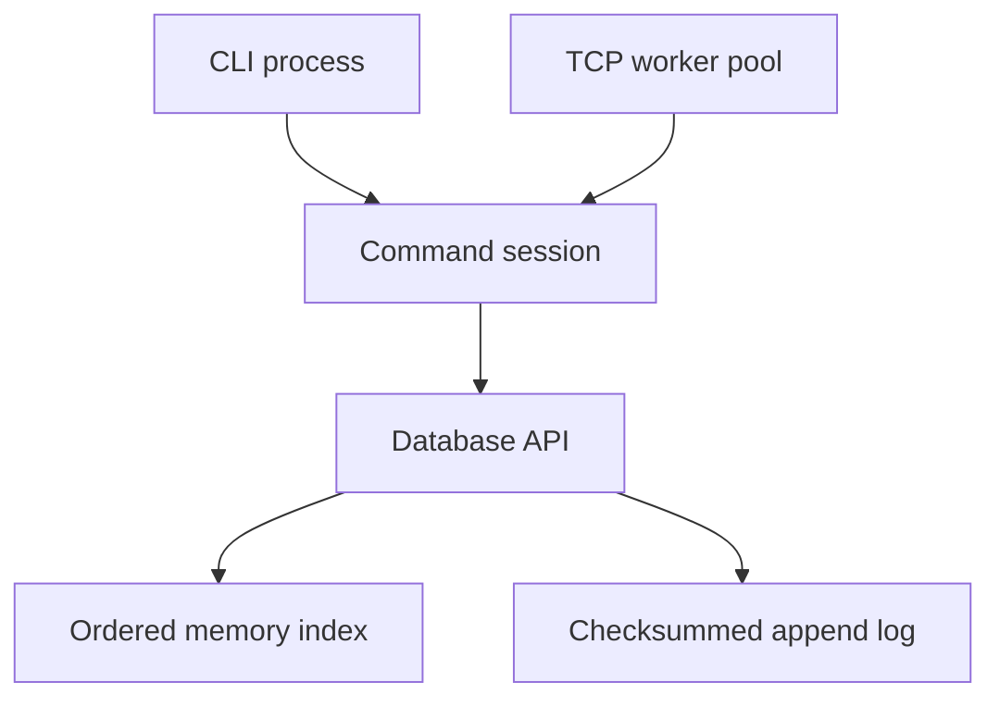

# Architecture

MiniDB separates the persistent storage API from command parsing and transport. The CLI and TCP server share the same command session, so quoting rules, error behavior, and batch semantics have one implementation.

## Components

| Component | Implementation | Responsibility |
| --- | --- | --- |
| Original memory store | `key_value_store.hpp` and `.cpp` | Portable hash-based API with no persistence |
| Persistent database | `database.hpp` and `.cpp` | Ownership, ordered index, locks, commits, recovery, scans, compaction |
| WAL codec | `src/wal.hpp` and `.cpp` | Explicit little-endian encoding, limits, checksums, strict decoding |
| Command session | `command.hpp` and `.cpp` | Tokenization, JSON responses, private pending writes |
| CLI | `apps/cli.cpp` | Bounded stdin lines and script exit codes |
| Server | `apps/server.cpp` | Socket lifecycle, fixed workers, bounded queue, shutdown |
| Python client | `clients/python/minidb_client.py` | Byte escaping, response parsing, batch context, connection errors |
| Independent inspector | `tools/inspect_wal.py` | Read-only validation with Python struct and zlib |

## Commit sequence

Each `Database::write` obtains the unique side of a `shared_mutex` and follows this order:

1. Reject a poisoned handle. Validate the complete batch and encode a bounded record.
2. Prepare the final updates and erases in temporary containers. A clear operation discards all earlier changes in that batch. All string/node allocations needed to publish the result occur here.
3. Append the entire frame, retrying interrupted writes and handling short writes.
4. In the default mode, call `fsync` before acknowledging the commit.
5. Publish the prepared changes through map node transfer, string swap, and erasure. No full index copy is needed. Release the write lock.

Readers cannot observe the intermediate publication steps because the unique lock remains held. A successful write becomes visible before its API call returns. If append or synchronization fails, the handle is poisoned and all later operations reject it until it is closed and reopened.

The error does not mean that the write was rolled back: a complete frame might have reached storage before the error was reported. Likewise, losing a TCP response does not reveal whether COMMIT completed. The client deliberately does not reconnect and replay writes automatically.

`fsync` is also used after new log creation and after replacing a compacted file, with a separate directory synchronization for the directory entry. Newly created ancestor directories are not recursively synchronized. Underlying filesystem and device guarantees still matter.

## Index choice and cost

The persistent index is a `std::map<string, string>`. Ordered storage makes prefix scans straightforward and allows C++17 node transfer during publication. The original in-memory store remains an independent `unordered_map` example.

Let N be the number of live keys, K the number of distinct touched keys, B the encoded batch bytes, and R the returned scan rows. Ignoring string-comparison lengths and storage latency:

| Operation | Container work |
| --- | --- |
| GET and EXISTS | O(log N); GET also copies the returned value |
| Batch preparation | O(K log K) plus input/string work |
| Batch publication | O(K log N), plus erasing all existing entries if CLEAR occurs |
| Log append and CRC | O(B), plus synchronization latency in durable mode |
| Prefix scan | O(log N + R), plus copied key/value bytes |
| Compaction | O(N + live bytes) serialization under the unique lock |
| Recovery | Log-byte parsing plus applying replayed operations to the index |

String comparison, hashing, encoding, and copied bytes are part of real costs; these are not unconditional constant-time operations. The batch input itself may contain repeated operations beyond K. Memory contains all live strings, index nodes, and bounded temporary batches or scan results.

## Concurrency

One owning process holds `flock` on `LOCK`. Keeping the lock on a separate file preserves ownership while `data.log` is replaced during compaction. This is advisory locking: unrelated software that ignores the lock is outside the model.

Within that process, GET, EXISTS, SIZE, STATS, and SCAN use shared locks. Writes, synchronization, and compaction use a unique lock. A SCAN call returns one consistent copy; two separate GET calls are not a shared snapshot. No fairness or starvation guarantee is claimed for `std::shared_mutex`.

Every TCP connection has its own command session and uncommitted batch. A fixed number of worker threads handle connections. The waiting queue has four slots per worker. A client keeps a worker until it closes or times out; this is deliberately simpler than an event-driven server and is unsuitable for large idle-connection counts.

SIGINT and SIGTERM set a signal-safe stop flag. The accept loop polls periodically, the pool shuts down active sockets, queued sockets close, workers join, and the database synchronizes before exit. SIGKILL provides none of those cleanup steps and is covered separately in restart tests.

## Boundaries

The database does not implement transactions with read sets, conflict detection, isolation levels, or read-your-writes snapshots. Atomic batches provide ordered all-at-once publication and one complete WAL frame. Compaction is synchronous; startup replays the entire remaining history. There is no automatic memory eviction or disk-backed search index.

The network layer is a local development interface without authentication, TLS, or remote exposure. Limits constrain individual requests, batches, and scan output, but live database growth is not globally quota-limited.

## System references

- [Linux fsync documentation](https://man7.org/linux/man-pages/man2/fsync.2.html) explains file and directory synchronization.
- [Linux rename documentation](https://man7.org/linux/man-pages/man2/rename.2.html) describes replacement and open-file behavior.
- [Linux flock documentation](https://man7.org/linux/man-pages/man2/flock.2.html) describes advisory directory ownership through the lock file.
